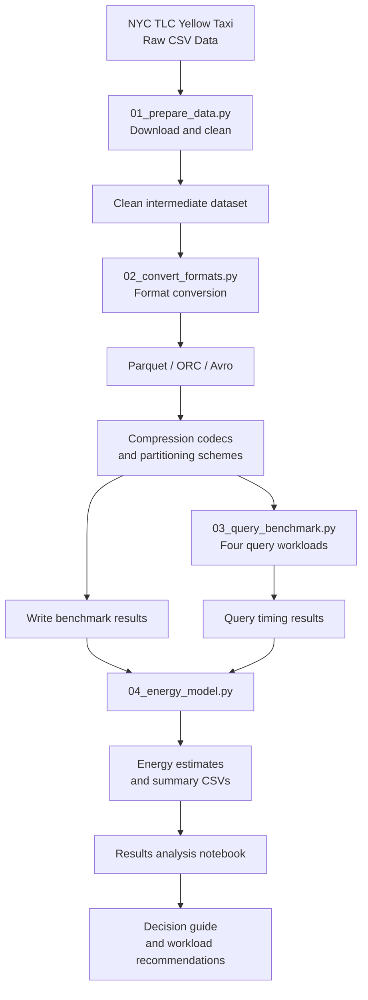

# File Format, Compression and Energy Trade-offs

**Big Data Systems & Responsible AI Engineering — Project 34, Track G (Governance, Compliance and Sustainability)**

**Case study:** A platform team must choose storage settings for petabytes of data.

We benchmark **Parquet, ORC and Avro** with different compression codecs and partitioning schemes on NYC TLC Yellow Taxi trip data. We compare query time, storage size and estimated energy, then recommend settings for interactive analytics, batch ETL and archival workloads.

## Team

| GitHub | Role |
|---|---|
| [@Shlokareddyt](https://github.com/Shlokareddyt) | Benchmark pipeline, energy model |
| [@sirisanikop](https://github.com/sirisanikop) | Decision guide, presentation |

## Architecture

The benchmark is implemented as a reproducible pipeline. Raw trip data is prepared, converted into the tested storage configurations, queried, and passed through the energy-estimation stage. The resulting CSV files are analyzed to support the decision guide.



## Repository layout

```text
.
├── README.md
├── requirements.txt
├── scripts/
│   ├── 01_prepare_data.py     # download-and-clean -> tidy intermediate file
│   ├── 02_convert_formats.py  # writes Parquet/ORC/Avro configurations
│   ├── 03_query_benchmark.py  # runs representative queries
│   └── 04_energy_model.py     # estimates energy from CPU/wall time
├── data/
│   ├── raw/                   # downloaded NYC TLC CSVs (gitignored)
│   └── converted/             # generated format/codec/partition data (gitignored)
├── results/                   # benchmark CSV outputs
├── notebooks/
│   └── results_analysis.ipynb # tables, charts and comparisons
├── docs/
│   ├── decision_guide.md      # recommendations and rationale
│   └── datasheet.md           # dataset data card
└── slides/                    # presentation material
```

`data/raw` and `data/converted` are not checked into git because they can be regenerated by rerunning the scripts. The benchmark CSV outputs in `results/` should be retained so the analysis and decision guide can be reviewed without rerunning the full benchmark.

## Reproducing the benchmark

Run these commands from the repository root.

### 1. Create and activate a virtual environment

```bash
python3 -m venv venv
source venv/bin/activate
```

### 2. Install dependencies

```bash
pip install -r requirements.txt
```

### 3. Run the pipeline

```bash
python scripts/01_prepare_data.py
python scripts/02_convert_formats.py
python scripts/03_query_benchmark.py
python scripts/04_energy_model.py
```

The conversion and query stages may take several minutes. The scripts should be run in order because each stage uses outputs from the preceding stage.

### 4. Analyze the results

Open `notebooks/results_analysis.ipynb` in VS Code or Jupyter and select the project's virtual-environment kernel. The notebook reads the CSV outputs from `results/` and generates the analysis tables and charts.

## Dataset

The input is three months (January–March 2021) of NYC Yellow Taxi trip records. The project run reported approximately **4.67 million cleaned rows**.

Source: [NYC TLC Trip Record Data](https://www.nyc.gov/site/tlc/about/tlc-trip-record-data.page), accessed through the [DataTalksClub/nyc-tlc-data](https://github.com/DataTalksClub/nyc-tlc-data) GitHub mirror.

See `docs/datasheet.md` for dataset provenance, intended use and limitations.

## What we tested

| Dimension | Values |
|---|---|
| Format | Parquet, ORC, Avro |
| Codec | Parquet: Snappy, Gzip, Zstd, none. ORC: Zlib, Zstd, uncompressed. Avro: Deflate, Snappy, null/no compression |
| Partitioning | None; by pickup date; by pickup date and coarse pickup-zone group |
| Queries | Point lookup, full-scan aggregation, wide scan, trailing-week range filter |

**Actual result counts from the completed run:** 30 write benchmark configurations and 120 query benchmark measurements (30 configurations × 4 query workloads). Codec availability differs by format, so not every format supports every codec.

## Key results

See the CSV files in `results/` and the analysis notebook for the measured values and comparisons.

The current analysis indicates that Parquet provided the best overall analytical performance in this single-machine experiment, with a smaller average output size and lower average query execution time than ORC and Avro for the tested workloads. Partitioning helped selective lookups and date-range queries when the query predicates aligned with the partition columns; broad full scans benefited less.

The best codec and partitioning scheme depend on the workload. Consult `docs/decision_guide.md` for the detailed recommendations rather than assuming one configuration is optimal for every case.

## Cost, energy and petabyte-scale interpretation

The benchmark records storage size and produces petabyte-scale storage projections. A monetary storage-cost estimate requires an explicit pricing assumption (for example, a selected provider, storage tier, region and price per TB-month). Do not interpret projected storage size alone as a measured cloud bill.

Energy values are estimates derived from measured CPU/wall time and an assumed power model; no hardware power meter was used. Petabyte-scale values are linear extrapolations from the sample benchmark, not measurements on a real petabyte-scale cluster.

## Honest scope note

This experiment ran on a single machine using a sample of public NYC TLC data. Results depend on hardware, software versions, cache state, query implementation and data layout. A distributed production system adds factors such as parallelism, network transfer, replication, metadata, compaction and fault tolerance. Treat the results as comparative evidence for this setup, not as guaranteed production performance.

## Main deliverables

- Benchmark scripts in `scripts/`
- Benchmark results in `results/`
- Analysis notebook in `notebooks/`
- Workload recommendations in `docs/decision_guide.md`
- Dataset data card in `docs/datasheet.md`
