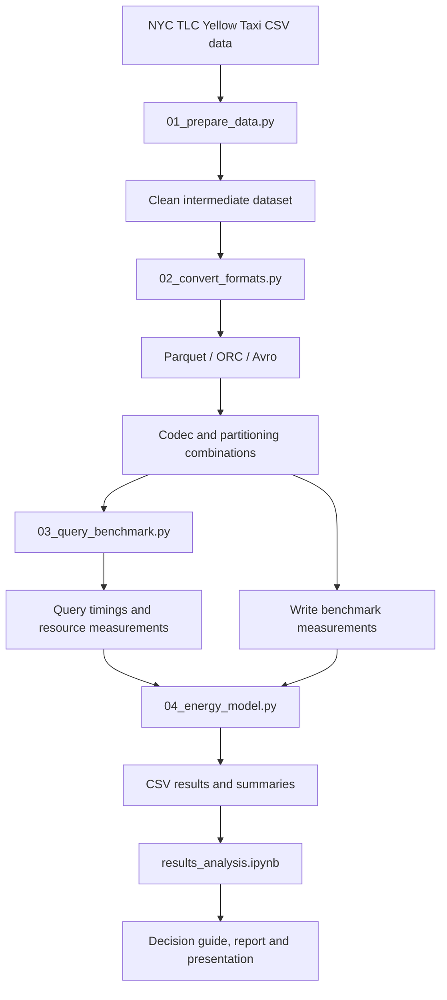

# File Format, Compression and Energy Trade-offs

**Big Data Systems & Responsible AI Engineering — Project 34, Track G**  
**Case study:** Selecting storage settings for large-scale data platforms.

## Project objective

This project benchmarks **Parquet, ORC and Avro** using NYC TLC Yellow Taxi trip records. It compares compression codecs and partitioning strategies across storage size, write time, query latency and estimated energy consumption. The goal is to recommend practical configurations for interactive analytics, batch ETL and archival workloads.

## Team

| GitHub | Contribution |
|---|---|
| [@Shlokareddyt](https://github.com/Shlokareddyt) | Benchmark pipeline and energy model |
| [@sirisanikop](https://github.com/sirisanikop) | Decision guide and presentation |

## Architecture



## Repository structure

```text
.
├── README.md
├── requirements.txt
├── scripts/
│   ├── 01_prepare_data.py
│   ├── 02_convert_formats.py
│   ├── 03_query_benchmark.py
│   └── 04_energy_model.py
├── data/
│   ├── raw/                  # downloaded source data; not committed
│   └── converted/            # generated files; not committed
├── results/                  # benchmark CSV outputs
├── notebooks/
│   └── results_analysis.ipynb
├── docs/
│   ├── decision_guide.md
│   ├── datasheet.md
│   └── technical_report.md
└── slides/
    └── content.md
```

## Requirements

Python 3.9 or later is recommended. Install dependencies in a virtual environment:

```bash
python3 -m venv venv
source venv/bin/activate
python -m pip install --upgrade pip
pip install -r requirements.txt
```

If you use the analysis notebook, register the environment as a Jupyter kernel:

```bash
python -m ipykernel install --user --name bdsraie --display-name "BDSRAIE"
```

## Reproducing the benchmark

Run commands from the repository root:

```bash
python scripts/01_prepare_data.py
python scripts/02_convert_formats.py
python scripts/03_query_benchmark.py
python scripts/04_energy_model.py
```

The scripts form a sequential pipeline: prepare the input data, convert it into the tested formats, execute representative queries, and estimate energy from measured resource usage. The conversion and query stages may take several minutes depending on hardware and dataset size.

Open `notebooks/results_analysis.ipynb`, select the `BDSRAIE` kernel, and use **Run All** to regenerate the analysis figures and tables from the CSV files in `results/`.

## Experimental design

| Dimension | Configurations |
|---|---|
| File formats | Parquet, ORC, Avro |
| Compression | Format-supported Snappy, Gzip, Zstd, Deflate, Zlib, uncompressed/none |
| Partitioning | None, pickup date, pickup date plus coarse zone group |
| Query workloads | Point lookup, full-scan aggregate, wide scan, trailing-week range filter |

The experiment records write duration and output size, query wall-clock and CPU time, and estimated energy. Codec availability differs by format; comparisons should be made only among supported combinations.

## Main findings (from the current benchmark outputs)

- **Parquet** had the lowest average query time in the current single-machine experiment (about 0.079 seconds), followed by **ORC** (about 0.466 seconds); **Avro** was much slower for these analytical query workloads (about 22.13 seconds).
- The reported average output sizes were approximately **113.04 MB for Parquet**, **146.22 MB for ORC**, and **325.96 MB for Avro**. These are averages over the tested configurations, not universal format-size guarantees.
- Partitioning substantially improved selective lookups and range filters when the query predicate aligned with the partition columns. It offered little benefit for full scans and can add file-management overhead.
- The measured best configuration varies by query type. Use the detailed CSV results and `docs/decision_guide.md`, rather than treating one configuration as optimal for every workload.
- The energy results are estimates from a documented CPU/I/O power model, not direct wall-socket measurements.

## Scope and limitations

The benchmark was run on a single machine using a sample of public NYC TLC data. Petabyte-scale values are **linear extrapolations**, not measurements on a distributed petabyte cluster. Results depend on hardware, software versions, cache state, data layout, query engine and workload. Repeat the experiment on representative production infrastructure before making procurement or capacity decisions.

## Outputs

The `results/` directory contains the measured CSV outputs and derived summaries. The notebook visualizes these outputs. Raw and converted data are excluded from version control because they can be regenerated by the scripts.

See:
- [`docs/decision_guide.md`](docs/decision_guide.md)
- [`docs/datasheet.md`](docs/datasheet.md)
- [`docs/technical_report.md`](docs/technical_report.md)
- [`slides/content.md`](slides/content.md)
